# Relay — multichannel outreach in two modes, one window

> Clickable prototype for the **Product Analyst & Prototyper (AI-Driven)** assignment:
> a system to create and run a multichannel outreach campaign (Email, LinkedIn,
> WhatsApp, Telegram, Signal, SMS, calls) with a **Simple** and a **PRO** mode
> switched from the header.

| Deliverable | File |
|---|---|
| **Prototype** — one self-contained HTML file (~400 KB, no dependencies, works offline) | [`index.html`](index.html) |
| **Screen recording** — ≈ 2½ min, 1080p, both modes and the logic, RU UI with RU/EN captions | [`demo/relay-demo.mp4`](demo/relay-demo.mp4) |
| Product notes — users, metrics, tracking plan, hypotheses | [`docs/PRODUCT.md`](docs/PRODUCT.md) |
| Architecture — engine, rendering, testing | [`docs/ARCHITECTURE.md`](docs/ARCHITECTURE.md) |
| Demo script with timestamps | [`docs/DEMO_SCRIPT.md`](docs/DEMO_SCRIPT.md) |

**Open it:** double-click `index.html` (Chrome / Edge / Safari / Firefox). Nothing to install.

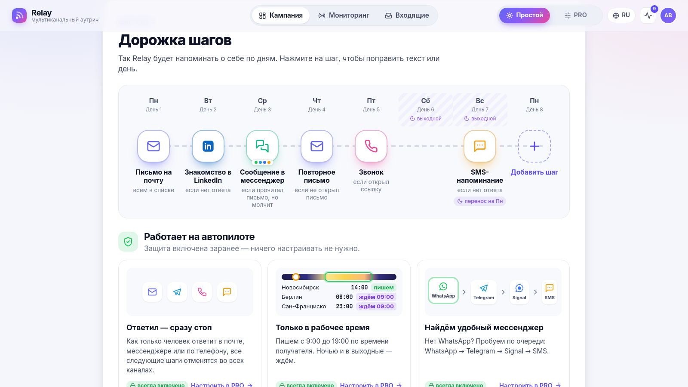

---

## What makes it more than a mock-up

* **A real engine behind the UI.** `src/engine.js` is a deterministic
  discrete-event simulator. The demo audience (48 decision makers, 7
  countries, 9 timezones) is actually *run* through the sequence, so every
  protection really happens and is shown as it happens: night deferrals,
  weekend shifts, the LinkedIn daily cap overflowing to tomorrow, the
  messenger cascade, links cut from first messages, voicemail detection, and
  the **auto-stop of the whole chain on a reply in any channel**.
* **One campaign, two lenses.** Simple and PRO render the same data model;
  switching (a circular View-Transition reveal) never loses anything.
* **Consequences before launch.** PRO recomputes a forecast, a ban-risk
  score and a preflight checklist on every change, with **one-click fixes**.
  Cross-setting validation catches hidden couplings: turn the email pixel off
  and every “read / not read” branch that depends on it lights up red on the
  logic map.
* **Product analytics built in.** The tracking plan from `docs/PRODUCT.md` is
  implemented: events stream into a drawer (activity icon in the header) with
  time-to-launch, mode switches and PRO settings counters; export to JSON.
* **Engineering hygiene.** 37 unit tests (engine invariants, AI drafts vs
  channel rules, i18n parity) + a 22-check Playwright e2e run, RU/EN i18n,
  persistence, keyboard & screen-reader basics, `prefers-reduced-motion`,
  zero runtime dependencies.

## Requirement coverage

| Requirement (from the brief) | Where / how to see it |
|---|---|
| Two modes in one window, switch in the header | `Simple ↔ PRO` toggle, top right. Same campaign in both. |
| **Simple:** big clean UI without jargon | Light theme, 17 px base type, plain-language copy (“if they read the email but stay silent”). |
| Step 1 — who we write to | CSV upload (drag & drop), paste a list, or the demo list → channel coverage + timezones detected from phone codes. |
| Step 2 — what we want to agree on, **text or voice** | Big text field + **“Say it”** mic (Web Speech API, scripted fallback) + goal chips + tone → AI writes every step. |
| Step 3 — clear visual track of steps by days | Day ruler (Mon…, weekends shaded) with step bubbles, plain conditions, “+” to add, click to edit (side sheet). |
| Auto-stop of the whole chain on a reply **in any channel** | Engine `stopLead()`; Simple feed “Chain stopped for Anna — cancelled 3 steps”; inbox divider; PRO log `auto_stop`. Tested. |
| Send only in the client’s working hours | Engine `inWindow / nextWindow` in the recipient’s timezone (from the phone code), weekends skipped. Autopilot card shows who waits. Tested. |
| Messenger cascade WhatsApp → Telegram → Signal → SMS | Engine cascade; preview “For Anna the cascade picks WhatsApp”; feed “No WhatsApp for Ryan → Telegram”; reorder/toggle in PRO. Tested. |
| **PRO:** flexible settings when a step is expanded | Each step: *Message* (variables, per-channel preview, counters, validation) · *Logic & timing* · *Channel settings*. |
| Email: mailbox rotation, daily limits, warm-up, pixel off | Mailbox table (health, age, today’s cap, forecast peak, on/off), round-robin vs by-health, cap slider with safe zones, warm-up ramp + sparkline, pixel / click tracking / plain text. |
| LinkedIn: like warm-up, daily invite limit, proxy | Like N days before + profile view, invite cap slider (≈ per week shown), note ≤ 300, residential/dedicated/none proxy with status. |
| WhatsApp / Telegram / Signal: no links in the first message, typing simulation, voice & video notes, hard per-number daily caps | Per-messenger tabs; link is cut from the first message (preview shows it); “typing…” + speed; AI voice notes, Telegram video circles; per-number cap + usage bars per number. |
| SMS: 160-char limit, timezones by number code, stop words | GSM-7 160 / UCS-2 70 meter counted with the longest name in the list, “keep to one SMS” + AI shorten fix; phone → timezone tester; stop-word chips (matched against real reply text → unsubscribe everywhere). |
| Call: local number, answering-machine detection, AI voice or transfer to a manager | Local caller ID per city, AMD with voicemail / retry / SMS policy, AI voice · AI → manager (warm transfer) · manager. |
| Branching: read / didn’t reply / clicked | Per-step condition (no reply · read · not read · clicked) referencing an earlier step, with availability reasons; logic map draws the branches. |
| Unified inbox with a traffic light of lead statuses | All channels in one list, traffic light filter (green / yellow / red), AI intent + confidence, full multichannel thread incl. the auto-stop moment, AI reply draft, manual override of the light. |
| HTML file + 2–3 min screen recording | `index.html` + `demo/relay-demo.mp4` (recorded by `scripts/record-demo.mjs` from the real app). |

## Screens

| | |
|---|---|
| 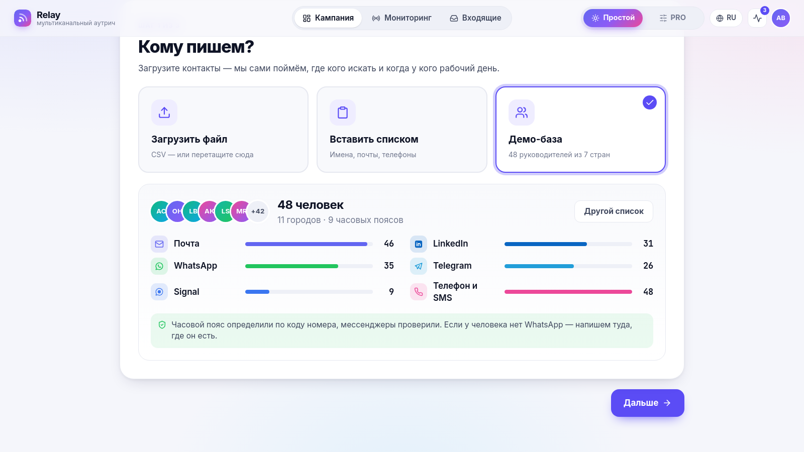 **Simple · 1. Who** | 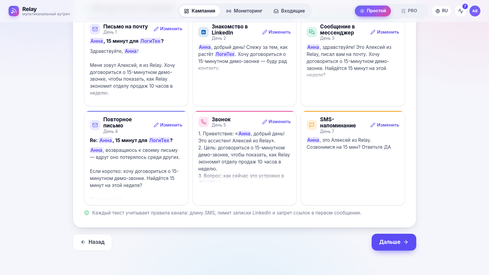 **Simple · 2. Goal → AI drafts** |
| 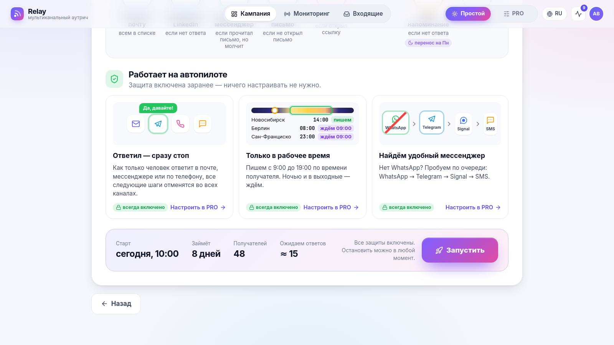 **Simple · 3. Autopilot** | 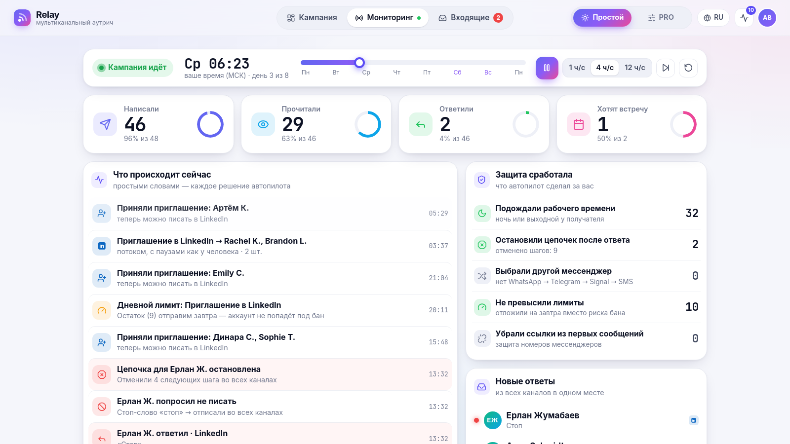 **Live · plain-language feed** |
| 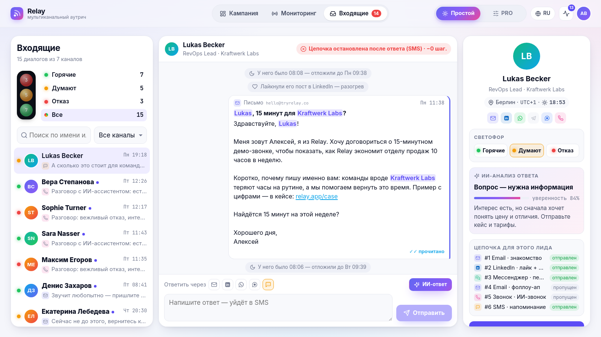 **Unified inbox** | 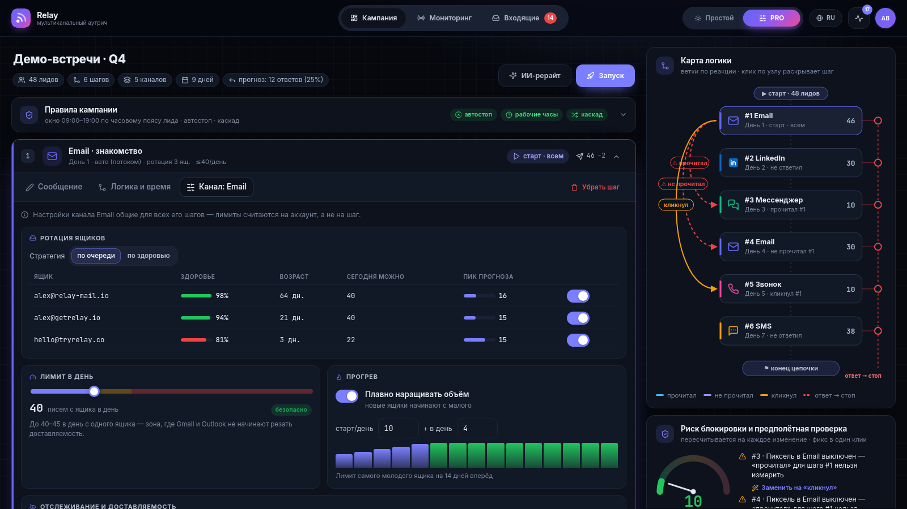 **PRO · Email, pixel off → broken branches** |
| 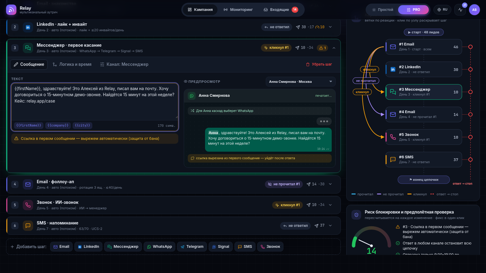 **PRO · Messenger, link cut** | 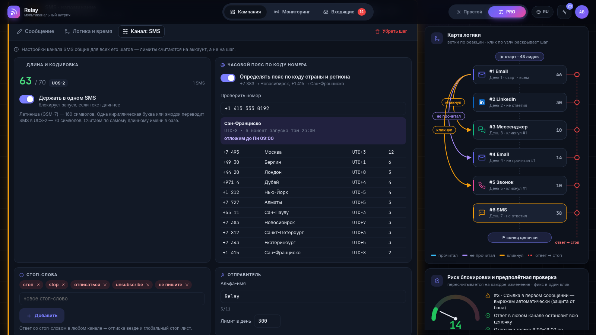 **PRO · SMS** |
| 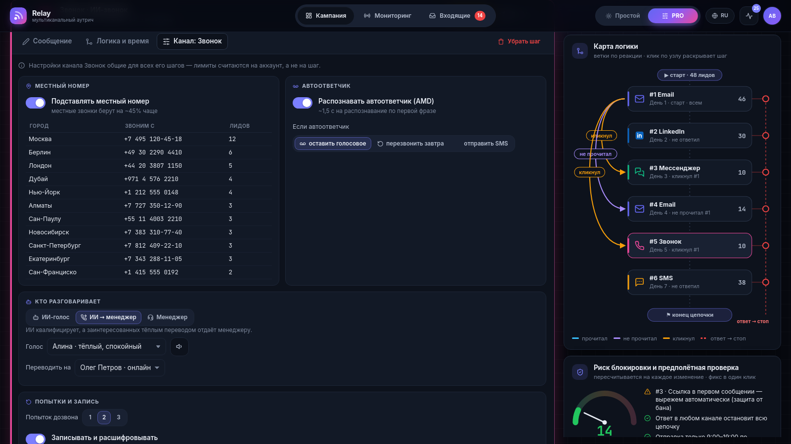 **PRO · Call** | 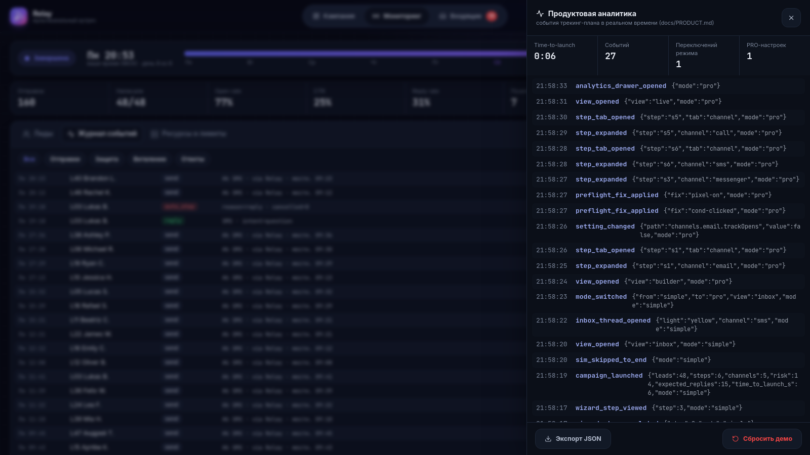 **Product analytics drawer** |

## Try this (2-minute tour)

1. **Simple:** *Demo list* → *Next* → *Say it* (or a goal chip) → *Write the
   messages* → *Next* → click a bubble on the track → **Launch**.
2. **Live:** watch the feed explain each decision; switch to *12 h/s*.
3. **Inbox:** click the green lamp → open a thread → see where the chain
   stopped → *AI reply* → *Send*.
4. **PRO** (header toggle) → *Campaign* → expand *Email → Channel* → turn
   the **pixel off** → watch the logic map and preflight → one-click fix.
5. Expand *LinkedIn → Channel* → drag the invite limit to 40 → risk gauge
   jumps → *Lower to 20*.
6. Expand *Messenger → Message* → add `relay.app/case` → preview shows the
   link cut from the first message.
7. Header → **RU/EN**; activity icon → the product analytics stream.

Want to try your own list? Drop [`docs/sample-leads.csv`](docs/sample-leads.csv)
(8 contacts, 8 timezones, `;`-separated) on the *Upload a file* card.

URL switches: `?lang=en` · `?mode=pro` · `?reset=1` (fresh state) ·
`?voice=sim` (force scripted dictation) · `?fast=1` (skip animations).

## What is real and what is simulated

| Real (working logic) | Simulated (no network) |
|---|---|
| Scheduling, working hours, weekends, cascade, limits & rotation, warm-up caps, link stripping, branching, auto-stop, AMD policy, stop-word matching — all in the engine | Delivery and provider APIs (ESP, LinkedIn, WhatsApp/Telegram/Signal, telephony) |
| SMS GSM-7/UCS-2 segmentation, phone-code → timezone, CSV/list import, validation, risk score, forecast | Who opens/clicks/replies (seeded personas — same seed, same campaign) |
| Voice input via the Web Speech API (Chrome/Edge, over http/https) | Messenger availability (country priors instead of a registration lookup) |
| i18n, persistence, analytics events | The “AI” copywriter and intent classifier: deterministic templates. In production an LLM would sit behind the same channel validators, which already exist as hard guardrails. |

A launched campaign is a frozen snapshot (campaign + seed): editing the
builder afterwards never rewrites the history the inbox shows.

## Develop, test, record

```bash
npm install                 # playwright-core + ffmpeg-static (dev only)
npm run build               # src/ → index.html (single file)
npm test                    # 37 unit tests (node:test)
npm run test:e2e            # 22-check end-to-end run in headless Chrome
npm run screenshots         # docs/img/*.png
npm run record              # demo/relay-demo.mp4 (≈ 2½ min, 1920×1080)
npm run verify              # build + unit + e2e
```

The e2e and recording scripts use the system Chrome (`CHROME=/path` to override).

```text
src/engine.js        deterministic simulator (protections, branching, projection)
src/data.js          demo audience, defaults, template copywriter, replies
src/i18n.js          [ru, en] dictionary + plurals
src/morph.js         keyed DOM morphing (~100 LOC)
src/app/*.js         state & validation, views (simple / pro / live / inbox), actions
src/styles.css       two design systems over one component set
scripts/             build, e2e, screenshots, demo recorder
tests/               engine, data, i18n
docs/                product notes, architecture, demo script, screenshots
```

## How it was built (AI-driven workflow)

Built with an AI coding agent in one session: spec → engine first (tested in
Node before any UI) → views → visual QA from automated screenshots → an
**two rounds of independent AI code review** (a separate read-only reviewer
agent). Round 1 found e.g. an un-frozen launch snapshot, PRO settings the
engine ignored, and an SVG keyboard crash; round 2 verified those fixes and
caught regressions they introduced (subdomain links no longer detected,
branch timing after a delayed step, substring stop-word matches). Every
finding was fixed and pinned by a regression test → scripted demo recording
from the real app. Tests caught a real product bug on the way:
English SMS + a Cyrillic name switches to UCS-2 and would have blocked launch.

## Known limitations

* Fixed UTC offsets (no DST); production would use IANA zones.
* The whole view re-renders from a string; fine at this scale, a production
  build would virtualise large tables and run the engine in a Web Worker.
* Desktop-first (≥ 1280 px); smaller screens stack the layout but aren’t polished.
* Voice input needs Chrome/Edge and a page served over http(s) for the
  microphone; from `file://` the scripted dictation runs instead.

## Credits

UI icons follow the [Lucide](https://lucide.dev) style (ISC); channel glyphs
are simplified marks drawn for this prototype. Fonts: Inter and JetBrains
Mono via Google Fonts with a system-font fallback. All people and companies
in the demo data are fictional.
